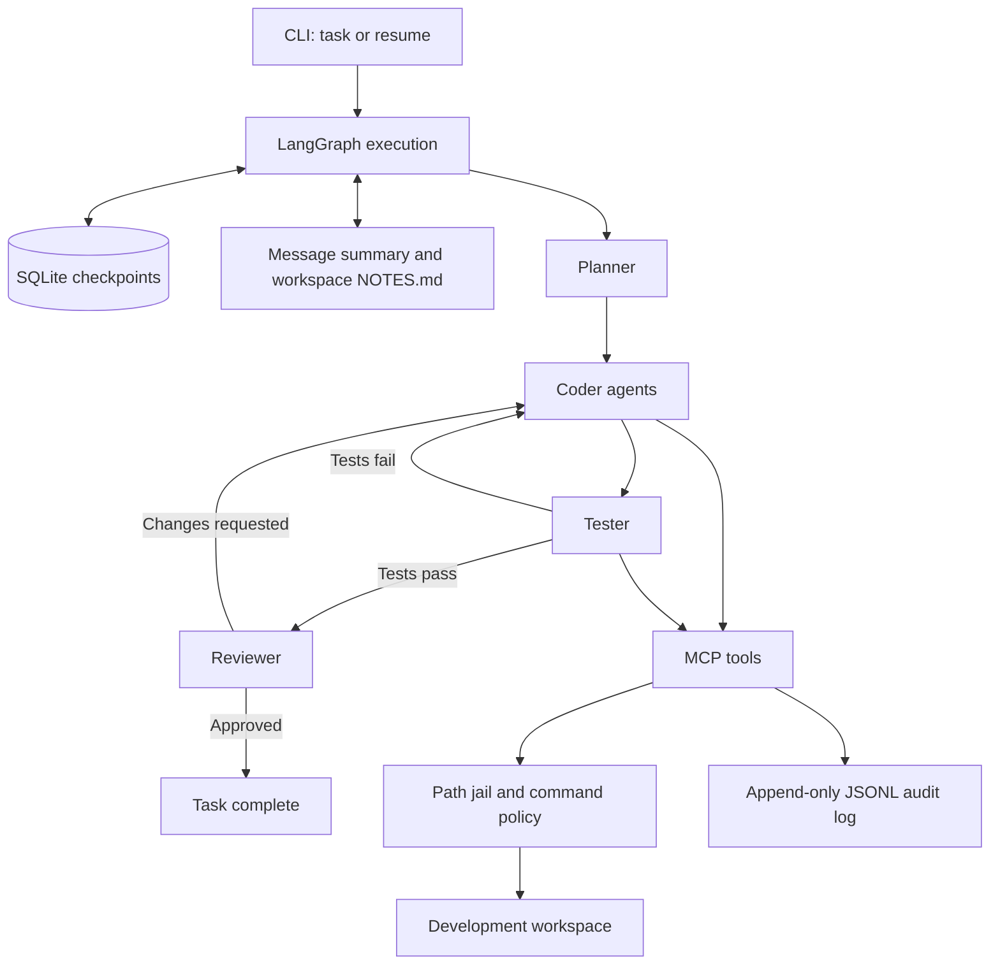

# tether

A long-running coding-agent harness that explores a practical question: how can
an agent work autonomously for hours without giving it unrestricted access to
your machine or production systems?

The goal is to give a coding agent a bounded development workspace, a small set
of tools, and durable execution state. If the harness is killed mid-run, it
should resume from its saved state and continue the task. Its actions should be
inspectable through an audit log.

**Status:** project setup. Milestone 1 is in progress; the command runner, MCP
server, agent graph, and checkpointing are not implemented yet. The architecture
below describes the intended design.

## What this project explores

- **Controlled tool access:** validate file paths and commands before execution.
- **Durable execution:** save graph state in SQLite and demonstrate recovery
  after an interrupted run.
- **Long-horizon coordination:** separate planning, coding, testing, and review,
  with test failures and review notes feeding back into coding.
- **Context management:** maintain a rolling message summary and workspace notes
  across runs.
- **Observability:** record each tool request, its outcome, and whether policy
  allowed or blocked it.

Tether is a portfolio project in agentic AI engineering. It is being built in
small milestones, with readable code and tests that make the design decisions
easy to inspect.

## Planned architecture

The harness owns the execution policy. The model requests actions through tools;
it does not decide which paths or commands are permitted. Planner and reviewer
roles will use stronger models, while coder roles can use cheaper models. Model
names will be configurable.

## Planned stack and layout

Python 3.11, LangGraph, LangChain, `langchain-mcp-adapters`, FastMCP from the `mcp`
package, `langchain-xai` with `ChatXAI`, LangGraph's `SqliteSaver`, and `unittest`.
Dependencies will be installed with `pip`.

| Module | Responsibility |
| --- | --- |
| `tether/sandbox.py` | Resolve paths and reject destinations outside the workspace, including symlink escapes. |
| `tether/commands.py` | Validate commands and run them with a fixed working directory, timeout, capped output, and `shell=False`. |
| `tether/server.py` | Expose `read_file`, `write_file`, `list_dir`, and `run_command` through FastMCP. |
| `tether/audit.py` | Append timestamped tool requests and result summaries to a JSONL log. |
| `tether/graph.py` | Coordinate planning, coding, testing, and review, with checkpoints. |
| `tether/memory.py` | Summarize older messages and load workspace `NOTES.md` at the start of a run. |
| `tether/cli.py` | Start tasks, resume a thread, and process a task backlog. |
| `tests/` | Exercise escape attempts, command policy, and recovery after interruption. |

Development starts on Windows 11 with PowerShell 5. The Python implementation
will also target Linux and macOS, using `pathlib` and avoiding `shell=True`.

## Isolation and recovery boundaries

A Python path jail constrains file tools. It does **not** provide OS-level
isolation for child processes. Allowed Node programs and npm scripts can execute
code, access the network, and spawn other processes. Enforced process isolation
is required before treating autonomous command execution as safe for an
untrusted agent.

The initial command policy will allow `npm`, `npx`, `node`, and `git`, with
`git push` blocked. The target workspace must contain no secrets and must never
connect to a real Supabase project. Supabase work will use local services or
mocks only.

Checkpointing also needs a careful boundary: restoring graph state does not
automatically make external tool effects execute exactly once. Recovery must
account for a command or file write that completed just before a crash. The
kill/resume demo will test and document the implemented behavior.

## Build milestones

Each milestone ends with a review before the next begins.

- [ ] **1. Workspace controls:** path jail, command allowlist, and passing escape tests.
- [ ] **2. MCP server:** expose the tools and verify them with the MCP Inspector.
- [ ] **3. Single agent:** complete a small task through a LangGraph loop using MCP tools.
- [ ] **4. Durable runs:** SQLite checkpoints, audit logging, and a kill/resume demo.
- [ ] **5. Multiple roles:** planner, coders, tester, and reviewer with configurable models per role.
- [ ] **6. Long runs:** memory, a backlog runner, and a reproducible demo script.

The eventual demonstration workload is **Codecave**, a Next.js and Supabase
developer-community app built in `workspace/codecave`. That workspace is kept
separate from the harness source and excluded from this repository by
`.gitignore`. Local environments, credentials, checkpoints, and runtime logs are
also excluded.
